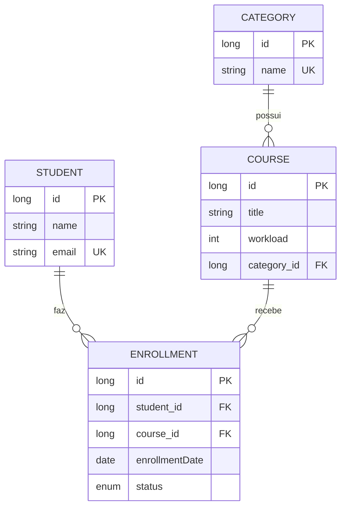

# AuthServer – Gestão de Cursos, Estudantes e Matrículas

API REST para gerenciar **categorias**, **cursos**, **estudantes** e as **matrículas** que ligam estudantes a cursos.
As operações que alteram ou removem dados (`PUT`, `PATCH`, `DELETE`) exigem autenticação por **token JWT**; as consultas
são públicas e aceitam **filtros e ordenação** por parâmetros de query.

## Autores

| Nome |
|---|
| João Pedro Cunha |
| Gustavo Jaques |

## LINK DO VÍDEO

Youtube - https://youtu.be/mXaxC8EA8Lo

## Sumário

- [Tecnologias](#tecnologias)
- [Modelo de dados](#modelo-de-dados)
- [Arquitetura e estrutura de pastas](#arquitetura-e-estrutura-de-pastas)
- [Como executar](#como-executar)
- [Autenticação](#autenticação)
- [Endpoints](#endpoints)
- [Consultas com filtro e ordenação](#consultas-com-filtro-e-ordenação)
- [Tratamento de erros](#tratamento-de-erros)
- [Logs](#logs)
- [Testes](#testes)
- [Observações](#observações)

## Tecnologias

| Item | Versão / uso |
|---|---|
| Kotlin | 2.2.21 |
| Java | 21 |
| Spring Boot | 4.0.7 (Web MVC, Data JPA, Validation, Security) |
| Banco de dados | H2 em memória (os dados são perdidos ao reiniciar) |
| Autenticação | JWT com a biblioteca jjwt 0.13.0 |
| Documentação | Swagger UI via springdoc-openapi 3.0.2 |
| Testes | JUnit 5, Kotest (asserções) e MockK |
| Build | Gradle (wrapper incluso) |

## Modelo de dados



São quatro classes com dois tipos de relacionamento:

- **One-to-many:** uma `Category` tem vários `Course`.
- **Many-to-many com tabela intermediária:** `Student` e `Course` se relacionam por meio de `Enrollment`, que guarda a
  data da matrícula e o status (`ACTIVE`, `COMPLETED` ou `CANCELLED`). Há uma restrição única que impede o mesmo estudante
  de se matricular duas vezes no mesmo curso.

**Regras de remoção:**

- Excluir um **estudante** ou um **curso** remove também as matrículas ligadas a ele.
- Excluir uma **categoria** que ainda tem cursos é recusado (HTTP 409), para nunca apagar cursos sem querer.

## Arquitetura e estrutura de pastas

Cada recurso tem seu próprio pacote, com uma classe por arquivo, e segue as mesmas camadas:
`Controller → Service → Repository`. Os controllers apenas convertem HTTP em DTO; as regras de negócio, os logs e as
exceções ficam nos services.

```
src/main/kotlin/br/pucpr/authserver
├── AuthserverApplication.kt
├── BootStrapper.kt                 # cria as roles e o usuário administrador iniciais
├── RootController.kt               # GET /health
├── GlobalExceptionHandler.kt       # converte exceções em respostas padronizadas
├── common/                         # Sorting: ordenação segura por lista de campos permitidos
├── exceptions/                     # NotFoundException, ConflictException, BadRequestException
├── security/                       # JWT, JwtAuthenticationFilter, SecurityConfig, CurrentUser
├── categories/                     # Category, Repository, Service, Controller, requests/, responses/
├── courses/                        # Course, Repository, Specifications, Service, Controller, requests/, responses/
├── students/                       # Student, Repository, Specifications, Service, Controller, requests/, responses/
├── enrollments/                    # Enrollment, EnrollmentStatus, Repository, Specifications, Service, Controller, ...
├── users/                          # base do curso: cadastro de usuários e login
└── roles/                          # base do curso: perfis de acesso
```

## Como executar

**Requisitos:** JDK 21 e acesso à internet na primeira execução (para o Gradle baixar as dependências).

```bash
./gradlew bootRun      # Windows: gradlew.bat bootRun
```

| O quê | Onde |
|---|---|
| API | `http://localhost:8080/api` |
| Swagger UI | `http://localhost:8080/api/` |
| Console do H2 | `http://localhost:8080/api/h2-console` (JDBC URL `jdbc:h2:mem:db`, usuário `sa`, senha `sa`) |
| Health check | `http://localhost:8080/api/health` |

Ao iniciar, é criado um usuário administrador: **`admin@authserver.com`** / **`admin`**.

O arquivo `requests.http` contém um roteiro completo de chamadas para o HTTP Client do IntelliJ.

### Configuração

| Propriedade | Variável de ambiente | Descrição |
|---|---|---|
| `security.jwt.secret` | `JWT_SECRET` | Chave de assinatura dos tokens (mínimo de 32 caracteres). Se não for definida, uma chave temporária é gerada a cada início e os tokens antigos deixam de valer. |
| `security.jwt.expiration-ms` | – | Validade do token (padrão: 24 horas). |

## Autenticação

1. Faça login para obter o token:

   ```bash
   curl -X POST http://localhost:8080/api/users/login \
     -H "Content-Type: application/json" \
     -d '{"email":"admin@authserver.com","password":"admin"}'
   ```

2. Envie o token no header `Authorization` das ações protegidas:

   ```bash
   curl -X DELETE http://localhost:8080/api/students/1 \
     -H "Authorization: Bearer <token>"
   ```

No Swagger UI, use o botão **Authorize** e cole o token; os endpoints protegidos aparecem com um cadeado.

**Como funciona:** a API não usa sessão (stateless). O `JwtAuthenticationFilter` valida a assinatura e a validade do token
a cada requisição. Cada ação destrutiva é protegida com `@PreAuthorize("isAuthenticated()")` no próprio controller.
Sem token, ou com token inválido ou expirado, a resposta é **401**.

## Endpoints

🔒 = exige token JWT.

### Categorias

| Método e rota | Auth | Descrição |
|---|:-:|---|
| `POST /categories` | | Cria uma categoria |
| `GET /categories` | | Lista as categorias |
| `GET /categories/{id}` | | Busca uma categoria |
| `PUT /categories/{id}` | 🔒 | Atualiza |
| `DELETE /categories/{id}` | 🔒 | Remove (409 se houver cursos) |

### Cursos

| Método e rota | Auth | Descrição |
|---|:-:|---|
| `POST /courses` | | Cria um curso já associado a uma categoria |
| `GET /courses` | | Consulta com filtros e ordenação |
| `GET /courses/{id}` | | Busca um curso |
| `PUT /courses/{id}` | 🔒 | Atualiza título, carga horária e categoria |
| `PUT /courses/{id}/category/{categoryId}` | 🔒 | Associa o curso a outra categoria |
| `DELETE /courses/{id}` | 🔒 | Remove o curso e suas matrículas |

### Estudantes

| Método e rota | Auth | Descrição |
|---|:-:|---|
| `POST /students` | | Cadastra (e-mail único, 409 se repetido) |
| `GET /students` | | Consulta com filtros e ordenação |
| `GET /students/{id}` | | Busca um estudante |
| `PUT /students/{id}` | 🔒 | Atualiza |
| `DELETE /students/{id}` | 🔒 | Remove o estudante e suas matrículas |

### Matrículas (associação entre estudantes e cursos)

| Método e rota | Auth | Descrição |
|---|:-:|---|
| `POST /enrollments` | | Matricula um estudante em um curso (`{"studentId": 1, "courseId": 1}`) |
| `GET /enrollments` | | Consulta com filtros e ordenação |
| `GET /enrollments/{id}` | | Busca uma matrícula |
| `PATCH /enrollments/{id}/status` | 🔒 | Altera o status (`{"status": "COMPLETED"}`) |
| `DELETE /enrollments/{id}` | 🔒 | Desfaz a matrícula |

## Consultas com filtro e ordenação

Todos os parâmetros são opcionais e podem ser combinados.

| Rota | Filtros | `sortBy` aceita |
|---|---|---|
| `GET /courses` | `title` (contém), `categoryId`, `minWorkload`, `maxWorkload` | `id`, `title`, `workload`, `category` |
| `GET /students` | `name` (contém), `email` (contém) | `id`, `name`, `email` |
| `GET /enrollments` | `studentId`, `courseId`, `status` | `id`, `enrollmentDate`, `status`, `student`, `course` |
| `GET /categories` | – | `id`, `name` |

`sortDir` é `ASC` (padrão) ou `DESC`. Um `sortBy` fora da lista retorna **400** com as opções válidas.

```
GET /api/courses?title=kotlin&categoryId=1&minWorkload=20&sortBy=workload&sortDir=DESC
GET /api/students?name=ana&sortBy=email
GET /api/enrollments?studentId=1&status=ACTIVE&sortBy=course
```

## Tratamento de erros

Os erros seguem o formato `ProblemDetail` (RFC 9457), por exemplo:

```json
{
  "status": 409,
  "title": "Conflict",
  "detail": "Já existe um estudante com o e-mail informado.",
  "instance": "/api/students"
}
```

| Status | Quando acontece |
|---|---|
| 400 | Parâmetro inválido (ex.: `sortBy` desconhecido, JSON malformado) |
| 401 | Ação protegida sem token, ou com token inválido ou expirado |
| 403 | Usuário autenticado sem permissão para a ação |
| 404 | Recurso inexistente |
| 409 | Conflito: e-mail ou matrícula duplicados, categoria com cursos, violação de integridade |
| 422 | Corpo da requisição não passou na validação (campos obrigatórios, e-mail inválido etc.) |
| 500 | Erro inesperado. A resposta é genérica e o detalhe fica apenas no log |

## Logs

- Os logs usam SLF4J, com parâmetros (`log.info("Curso {} criado", id)`), e não registram tokens nem senhas.
- **`info`**: criação e atualização. **`warn`**: remoções e acessos negados, sempre com o usuário que executou a ação.
  **`debug`**: consultas. **`error`**: falhas inesperadas, com stack trace.
- Além do console, os logs são gravados em `./logs/spring.log`.

## Testes

```bash
./gradlew test
```

| Tipo | O que cobre |
|---|---|
| Unitários dos services (MockK) | Regras de negócio: conflitos, recursos inexistentes, ordenação, associações |
| `JWTTest` | Token válido, adulterado, de outra chave e expirado |
| `DestructiveActionsSecurityTest` | Teste de ponta a ponta com servidor real: todas as ações destrutivas retornam 401 sem token válido, e o fluxo completo (criar, associar, consultar, remover) funciona com token |

## Observações

- Os módulos `users` e `roles` fazem parte da base fornecida no curso (cadastro de usuários e login) e não foram alterados
  neste trabalho. Por isso as rotas desses módulos continuam sem proteção.
- Como o banco é H2 em memória, todos os dados são recriados a cada execução.
